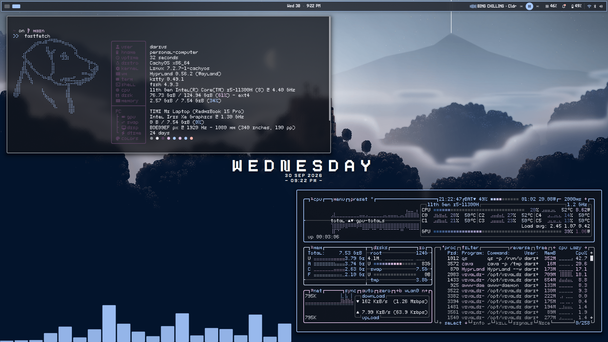

# vissarionn's dotfiles

Dotfiles for a fully pixel art rice I made in like two or so weeks.



## Included Configurations

Custom configs include configs for:
- DankMaterialShell (Since it's built on DMS)
- Rofi (Both an application menu and a power menu)
- Kitty
- Fastfetch
- SDDM (The lock screen, comes with only one theme, provided by qylock)

It also comes with a bunch of fonts and wallpapers (both static and animated) you can use.

## Dependencies

- DankMaterialShell (VERY IMPORTANT because the ENTIRE THING depends on it)
- Rofi
- Kitty
- Fastfetch
- skwd-wall
- SDDM

Optional: Niflveil (For minimising windows. Find it here: https://github.com/Mauitron/NiflVeil or simply accept when the setup script asks you if you want to install it)

## Automatic Installation & Setup

Clone the repository to your home directory:

```bash
cd ~
git clone https://github.com/vissarionn/dotfiles.git
cd dotfiles
```

Then run the setup script to install dependencies, copy configs, and install fonts/themes automatically:

```bash
chmod +x setup.sh
./setup.sh
```

> **Note:** I had some issues with Hyprland not loading at all and throwing a black screen instead while I was testing it. If you encounter the same problem, follow the steps below.

**Troubleshooting a black screen:**

Step 1: Open ~/.config/hypr/config/monitors.lua in a text editor of your choice (like nvim or vim)

Step 2: Change the `output` part of the code to match your monitor's name. If you don't know what your monitor is named, open a terminal and enter:

```bash
wlr-randr
```
It should show up in the output.

Here is an example:

```bash
> wlr-randr
eDP-1 "BOE 0x09EF  (eDP-1)"
  Make: BOE
  Model: 0x09EF
  Physical size: 340x190 mm
  Enabled: yes
  Modes:
    1920x1080 px, 60.000999 Hz (preferred, current)
    1920x1080 px, 48.001999 Hz
  Position: 0,0
  Transform: normal
  Scale: 1.000000
  Adaptive Sync: disabled
```
Here, `eDP-1` is my momitor.

After you change it, save and exit. You may also change your resolution and refresh rate if you want to.

## Keybindings

| Key combo | Action |
| :--- | :--- |
| `Alt` + `Q` | Open Terminal (Kitty) |
| `Alt` + `Space` | Close Window |
| `Alt` + `F` | Toggle Fullscreen |
| `Alt` + `R` | Toggle Floating Window |
| `Alt` + `S` | Application Menu (Rofi) |
| `Alt` + `X` | Power Menu (Rofi) |
| `Alt` + `1` | Minimise window (Niflveil) |
| `Alt` + `2` | Restore recently minimised window (NiflVeil) |
| `Alt` + `A` | Restore all minimised windows (NiflVeil) |
| `Alt` + `H` | View the rest of keybindings |
| `Ctrl` + `Shift` + `S` | Settings menu (DankMaterialShell) |

> **Note:** You can also change these keybinds in ~/.config/hypr/dms/binds.lua or via the DankMaterialShell settings menu.

## Credits

- DankMaterialShell (Now Dux): https://duxlabs.dev
- Rofi: https://github.com/davatorium/rofi
- Kitty: https://github.com/kovidgoyal/kitty
- Fastfetch: https://github.com/fastfetch-cli/fastfetch
- skwd-wall: https://github.com/liixini/skwd-wall
- SDDM: https://github.com/sddm/sddm
- qylock (The SDDM theme): https://github.com/Darkkal44/qylock
- NiflVeil: https://github.com/Mauitron/NiflVeil
